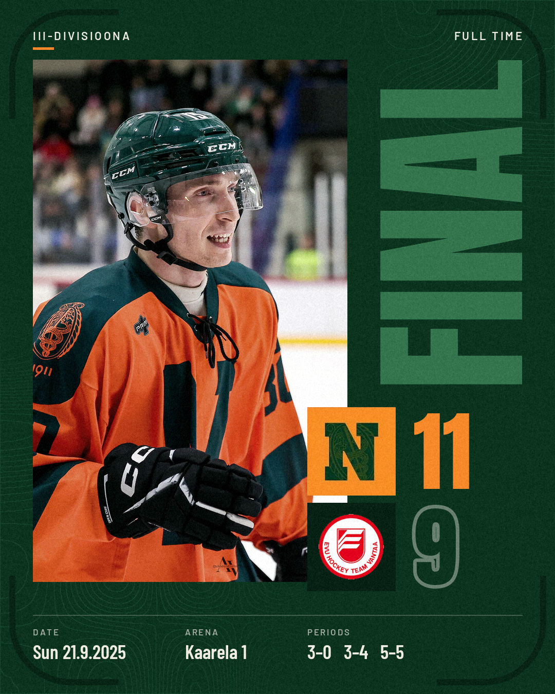
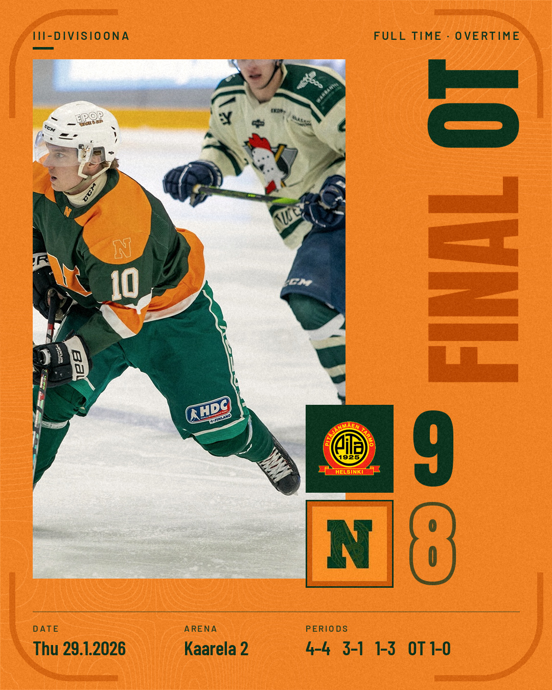
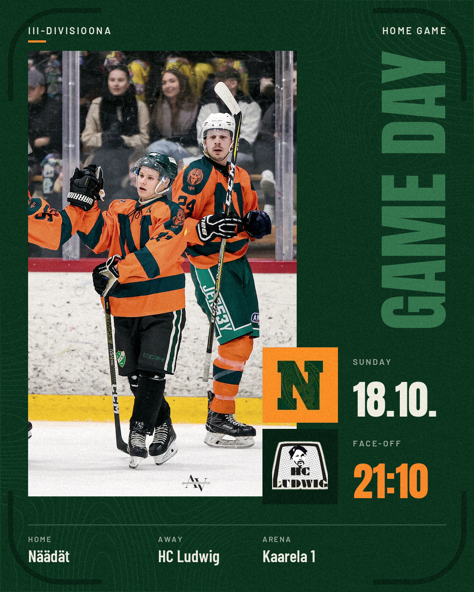
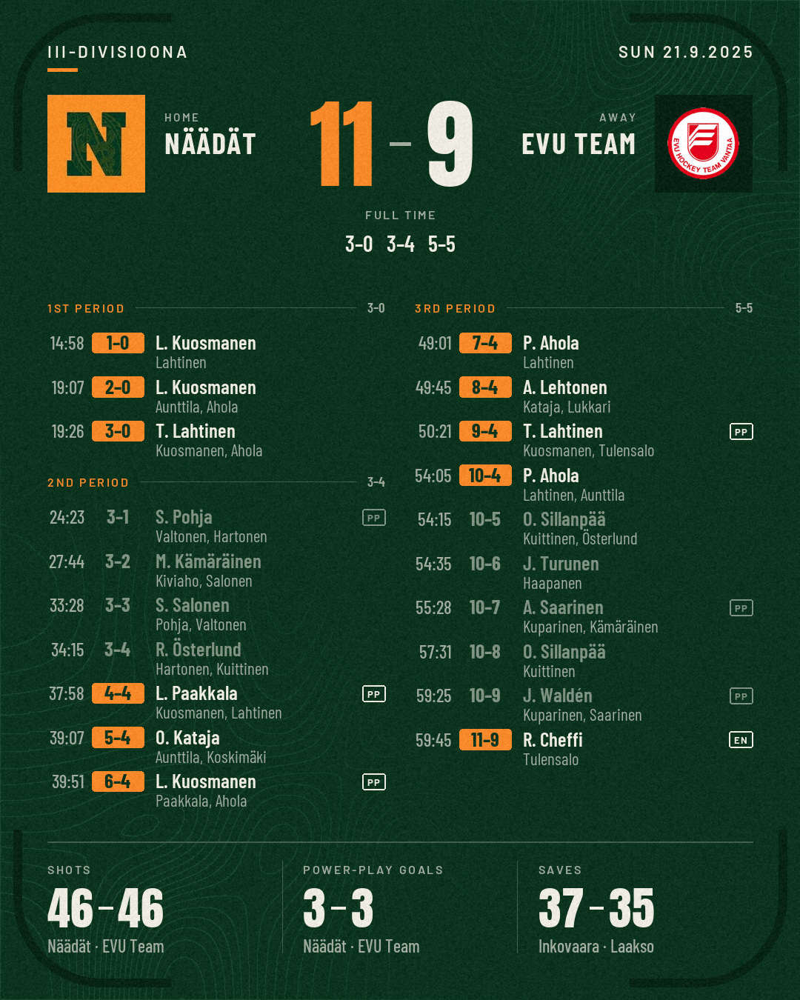

# Näädät game posts

An assistant skill that makes Näädät's Instagram posts around every game. Ask your AI assistant (Claude, Codex, ChatGPT and others) for "the game day post for tonight" or "the result post for last night's game", and you get the finished images plus a caption to copy. Every image is Instagram post size (1080x1350).

Home games get a green post and away games an orange one, automatically. Every post shows a real game photo from the skill's own photo library: you never need to send a photo, and the assistant switches photos from game to game.

**Pre-game post**, for game day:

- `pregame_feed.jpg`: GAME DAY, a game photo, both team logos, the date, face-off time and rink.
- An English caption that tells fans when and where to come.

**Post-game post**, after the final horn:

- **Slide 1** (`result_feed.jpg`): FINAL, a game photo, both team logos, the score, date, rink and period scores.
- **Slide 2** (`summary_feed.jpg`): every goal with time and assists, shots, power-play goals and goalie saves. Made when the goal log is known.
- An English caption, ready to copy.

Every caption ends with the team sign-off, the photographer credit for the photo used (for example `📸 @vanninenphotos`) and the team hashtags.

III-divisioona games are read from the official results service, tulospalvelu.leijonat.fi. FCAA games are not on that service, so you tell the assistant the details and it builds the post from them.

## Examples

| Result, home game | Result, away game |
|---|---|
|  |  |

| Game day post | Slide 2: goal summary |
|---|---|
|  |  |

## Install

1. Download [naadat-result-post.zip](dist/naadat-result-post.zip). On GitHub: click the file name, then the download button (the arrow at the top right of the file view).
2. Add it to your assistant:
   - **Claude (claude.ai or the desktop app)**: open Settings > Capabilities and turn on **Code execution and file creation** and network access (**Allow network egress**; on Team and Enterprise plans an owner adds `tulospalvelu.leijonat.fi` to the allowed domains). Then go to Customize > Skills, press **+** > **Create skill** > **Upload a skill**, choose the zip and switch the skill on.
   - **Claude Code**: copy the `naadat-result-post` folder (inside the zip, or `skills/naadat-result-post` in a clone of this repo) into `~/.claude/skills/`.
   - **Codex**: copy the same folder into `~/.agents/skills/`.
   - **Other assistants**: upload the zip in the chat and say "Unzip this, read naadat-result-post/SKILL.md and follow it."

Step-by-step instructions for each app, including the network settings and the Pillow install: [setup.md](skills/naadat-result-post/references/setup.md).

## How to use

Start a new chat and ask in your own words, for example:

- "Make the game day post for tonight's Näädät game."
- "Pre-game post for the FCAA game on Thursday: Näädät vs Harbour Hawks, 21:00 at Kaarela 1, home game. Logo attached."
- "Make the result post for last night's Näädät game."
- "Result post for the game on 18 October."
- "We played FCAA tonight: Näädät 5, Harbour Hawks 2, at home. Goals: Esimerkki 2, Malli 2, Kuvitteellinen 1. Logo attached."
- "Use a different photo." (after you have seen the first version)

The assistant first reads the game back to you (date, teams, home or away, and the time and rink or the score) and waits for your OK, so you can catch a wrong game. It then gives you the images and the caption. You post them yourself in the Instagram app; the assistant never posts anything.

A result post needs a final result. If the game is still being played or the official result is not in yet, the assistant tells you so and waits. If the game has not been played yet, it offers the game day post instead.

If the assistant cannot reach the results service, it asks you for the game link from tulospalvelu.leijonat.fi, and if needed for the game report: open the address it gives you in a browser and send the page in the chat. On iPhone: long-press the link, choose Download Linked File, then attach the file from the Files app; or open the page, select all the text, copy it and paste it in the chat.

### FCAA and other games not on the results service

For a **pre-game post**, tell the assistant the opponent, the date, the face-off time, the rink and whether Näädät play at home or away. For a **result post**, tell it the final score, the opponent, the date, home or away, whether it went to overtime or a shootout, and the scorers if you know them. Last names and goal counts are enough, and so is a partial scorer list: the assistant leaves out anything you did not give it rather than guessing first names or assists. If you forget something, the assistant asks.

Attach the opponent's logo if you have it; without one, the graphic shows a lettered badge.

## Photo credits

The posts use game photos by:

- **Vanninen Photos** ([@vanninenphotos](https://www.instagram.com/vanninenphotos/))
- **FCAA / Topias Rouhiainen**

The club holds the rights to use these photos in its own posts. The photos are bundled in [`skills/naadat-result-post/assets/photos/`](skills/naadat-result-post/assets/photos/) for that purpose only; ask the photographers before using them anywhere else. The caption of every post credits the photographer of the photo it shows.

## Changing logos, colours, hashtags and photos

Ask whoever maintains the skill: on claude.ai the installed skill cannot be edited, so every change goes into a new zip that everyone uploads again. For maintainers:

All team settings live in [`skills/naadat-result-post/assets/brand/team.json`](skills/naadat-result-post/assets/brand/team.json): team name, team logo, the caption sign-off, hashtags and the results-service ids. Each setting is explained in the file's `_help` block.

- **Team logo**: put a square PNG (1000 px or more) in `assets/brand/` and set its file name in `logo`.
- **Opponent logo**: for a single post, the user simply attaches the logo in the chat. To keep it for later games, put a PNG in `assets/logos/` named by the club's association id: the number in the link of the club's logo on tulospalvelu.leijonat.fi (for example `10115736.png`).
- **Colours**: change `GREEN`, `ORANGE` and `CREAM` near the top of `skills/naadat-result-post/scripts/render_card.py` (home posts use green, away posts orange).
- **Photos**: add a real camera photo the club may use (long edge about 1600 px, saved without metadata) to `assets/photos/` and add an entry for it to `assets/photos/photos.json` with the file name, the photographer credit exactly as it should appear in the caption, the crop centre (`focus`, as fractions of width and height) and the jersey colour. Add the photographer to the photo credits above.

Then rebuild the zip with `python tools/build_zip.py`, commit `dist/naadat-result-post.zip`, and ask everyone to download the new zip from the link above and upload it again. Claude Code and Codex read the copied skill folder directly, so there a change to that folder applies at once.

## No AI label

Every image is drawn by a plain Python script from the game data, the bundled fonts, real logo files and real camera photos, and saved without metadata. No image-generation model is used. The files carry none of the signals Meta reads for Instagram's "AI info" label: no C2PA Content Credentials, no IPTC/XMP "digital source type", no AI watermarks. The script refuses photos and logos whose file says they were made or edited with AI.

Instagram can still label a post for reasons outside the files, so when you post:

- Upload the files as they are. Skip Restyle, Meta AI edits and AI filters in the Instagram editor.
- Leave the AI label toggle under Advanced settings off.

## Fonts and licences

The graphics use [Anton](https://fonts.google.com/specimen/Anton), [Barlow](https://fonts.google.com/specimen/Barlow) and [Barlow Condensed](https://fonts.google.com/specimen/Barlow+Condensed), all under the SIL Open Font License 1.1. The licence texts are in `skills/naadat-result-post/assets/fonts/` (`OFL-Anton.txt`, `OFL-Barlow.txt`, `OFL-BarlowCondensed.txt`). Team logos belong to their clubs, and the photos to their photographers (see Photo credits).

## For developers

See [AGENTS.md](AGENTS.md). The skill itself is [`skills/naadat-result-post/SKILL.md`](skills/naadat-result-post/SKILL.md). Requirements: Python 3.8+ and Pillow 8.2+.
