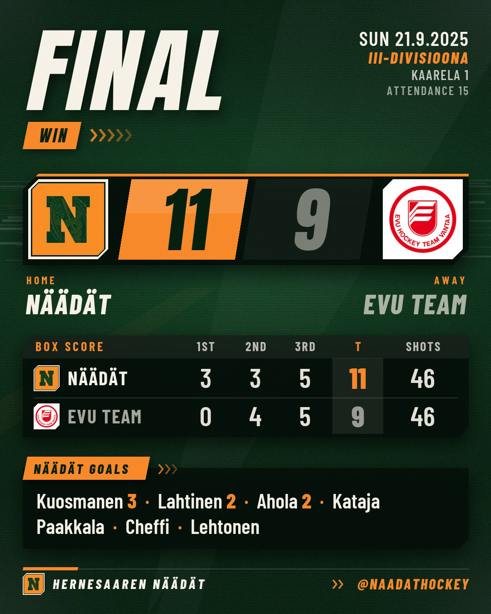

# Näädät game posts

An assistant skill that makes Näädät's Instagram posts around every game. Ask your AI assistant (Claude, Codex, ChatGPT and others) for "the game day post for tonight" or "the result post for last night's game". Every image is in Instagram post size (1080x1350).

**Pre-game post**, for game day:

- `pregame_feed.jpg`: competition, date, face-off time, rink and both team logos.
- An English caption that tells fans when and where to come, with the team sign-off and hashtags.

**Post-game post**, after the final horn:

- **Slide 1** (`result_feed.jpg`): FINAL, both team logos, the score, period scores, shots and Näädät's goal scorers.
- **Slide 2** (`summary_feed.jpg`): every goal with time and assists, shots and goalie saves. Made when the goal log is known.
- An English caption with the team sign-off and hashtags, ready to copy.

A story version (1080x1920) is made only when you ask for a story.

III-divisioona games are read from the official results service, tulospalvelu.leijonat.fi. FCAA games are not on that service, so you tell the assistant the details and it builds the post from that.

## Examples

| Pre-game | Post-game slide 1 | Post-game slide 2 |
|---|---|---|
|  |  |  |

## Install

Download [naadat-result-post.zip](dist/naadat-result-post.zip) (on GitHub: open the file and press the download button), then:

- **Claude (claude.ai or the desktop app)**: Customize > Skills > + > Create skill > Upload a skill, choose the zip and switch it on. Turn on code execution and network access under Settings > Capabilities first.
- **Claude Code**: copy the `naadat-result-post` folder (inside the zip, or `skills/naadat-result-post` in a clone of this repo) into `~/.claude/skills/`.
- **Codex**: copy the same folder into `~/.agents/skills/`.
- **Other assistants**: upload the zip in the chat and say "Unzip this, read naadat-result-post/SKILL.md and follow it."

Step-by-step instructions for each app, including the network settings and the Pillow install: [setup.md](skills/naadat-result-post/references/setup.md).

## How to use

Start a new chat and ask in your own words, for example:

- "Make the game day post for tonight's Näädät game."
- "Pre-game post for the FCAA game on Thursday: Näädät vs Harbour Hawks, 21:00 at Kaarela 1. Logo attached."
- "Make the result post for last night's Näädät game."
- "Result post for the game on 18 October."
- "Make the result post for the KHK game, and use this photo." (attach a real photo from the game)
- "We played FCAA tonight: Näädät 5, Harbour Hawks 2, at home. Goals: Esimerkki 2, Malli 2, Kuvitteellinen 1. Logo attached."

The assistant first reads the game back to you (date, teams, and the time and rink or the score) and waits for your OK, so you can catch a wrong game. It then gives you the images and the caption. You post them yourself in the Instagram app; the assistant never posts anything.

A result post needs a final result: if the game is still being played or the official result is not in yet, the assistant tells you so and waits.

If the assistant cannot reach the results service, it asks you for the game link from tulospalvelu.leijonat.fi, and if needed for the game report: open the address it gives you in a browser and send the page in the chat. On iPhone: long-press the link, choose Download Linked File, then attach the file from the Files app; or open the page, select all the text, copy it and paste it in the chat.

### FCAA and other games not on the results service

For a **pre-game post**, tell the assistant the opponent, the date, the face-off time and the rink. For a **result post**, tell it the final score, the opponent, the date, whether it went to overtime or a shootout, and the scorers if you know them. Last names and goal counts are enough, and so is a partial scorer list: the graphic marks it as partial, and the assistant leaves out anything you did not give it rather than guessing first names or assists.

Attach the opponent's logo if you have it; without one, the graphic shows a lettered badge. Games at Kaarela count as home games automatically; for any other rink, say whether Näädät played at home or away.

## Changing logos, colours and hashtags

Ask whoever maintains the skill: on claude.ai the installed skill cannot be edited, so every change goes into a new zip that everyone uploads again. For maintainers:

All team settings live in [`skills/naadat-result-post/assets/brand/team.json`](skills/naadat-result-post/assets/brand/team.json): team name, colours, the caption sign-off, hashtags, home rinks and the results-service ids. Each setting is explained in the file's `_help` block.

- **Team logo**: put a square PNG (1000 px or more) in `assets/brand/` and set its file name in `logo`.
- **Opponent logo**: for a single post, the user simply attaches the logo in the chat. To keep it for later games, put a PNG in `assets/logos/` named by the club's association id: the number in the link of the club's logo on tulospalvelu.leijonat.fi (for example `10115736.png`).
- **Colours**: edit the hex codes under `colors`.
- **Home rinks**: `home_arenas` ships as `["Kaarela"]`; a rink counts as home when its name starts with an entry (so Kaarela 1 and Kaarela 2 both match).

Then rebuild the zip with `python tools/build_zip.py`, commit `dist/naadat-result-post.zip`, and ask everyone to download the new zip from the link above and upload it again. Claude Code and Codex read the copied skill folder directly, so there a change to that folder applies at once.

## No AI label

Every image is drawn by a plain Python script from the game data, the bundled fonts and real logo files, and saved without metadata. No image-generation model is used. Without a photo, the files carry none of the signals Meta reads for Instagram's "AI info" label: no C2PA Content Credentials, no IPTC/XMP "digital source type", no AI watermarks. With a photo, the post is only as clean as the photo: a watermark that an AI edit left in its pixels stays in the picture. The script refuses photos and logos whose file says they were made or edited with AI.

Instagram can still label a post for reasons outside the files, so when you post:

- Upload the files as they are. Skip Restyle, Meta AI edits and AI filters in the Instagram editor.
- Leave the AI label toggle under Advanced settings off.
- Add only real camera photos. If a photo was edited with an AI tool (Magic Editor, Magic Eraser, Photoshop Generative Fill, Galaxy AI, iPhone Clean Up and similar), use the unedited original instead.

## Fonts and licences

The graphics use [Anton](https://fonts.google.com/specimen/Anton) and [Barlow Condensed](https://fonts.google.com/specimen/Barlow+Condensed), both under the SIL Open Font License 1.1. The licence texts are in `skills/naadat-result-post/assets/fonts/` (`OFL-Anton.txt`, `OFL-BarlowCondensed.txt`). Team logos belong to their clubs.

## For developers

See [AGENTS.md](AGENTS.md). The skill itself is [`skills/naadat-result-post/SKILL.md`](skills/naadat-result-post/SKILL.md). Requirements: Python 3.8+ and Pillow 8.2+.
